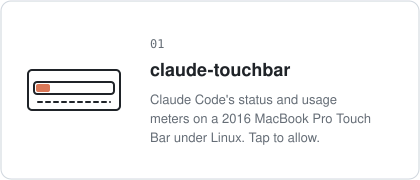
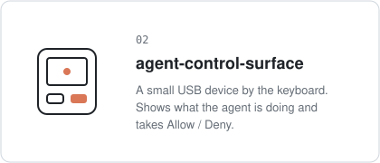
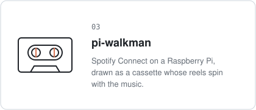
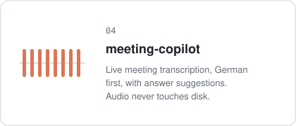
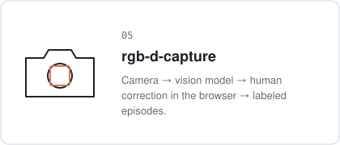
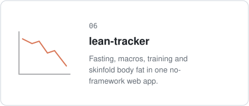

 

**Yang Song** · Frankfurt  
Small tools and devices, built with Claude Code and Codex.

 

###### INTERFACES FOR AGENTS

 

###### BUILT WITH AGENTS

 

 

 

[ysong.dev](https://ysong.dev)
